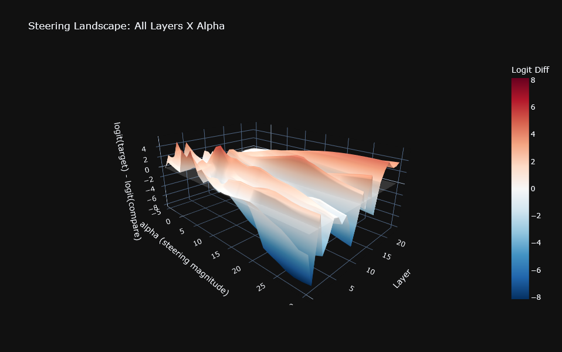
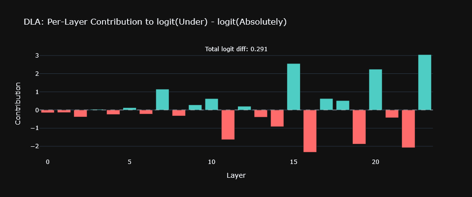
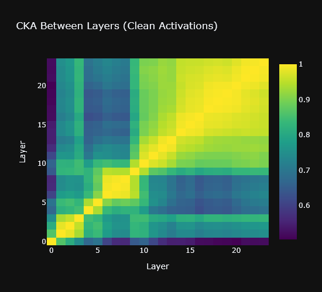

# Interpretability Explorer


An interactive tool for investigating behavioral directions in language models using mechanistic interpretability techniques. Built on [TransformerLens](https://github.com/TransformerLensOrg/TransformerLens) and [Gradio](https://gradio.app/).

> **Blog post**: [Coming soon!]()
> 
> **Case Study**: [Coming soon!]()


*An example of a Qwen-2.5-0.5B-Instruct alpha-layer sweep*

*Per-layer Direct Logit Attribution on the same model between two tokens*
## What is this?

Given paired prompts (clean vs. corrupt), this tool extracts a behavioral
direction from the residual stream via difference-in-means and provides
interactive analyses to characterize, visualize, and causally test that
direction.

This is an educational tool and the goal is to make interpretability more
accessible and hands-on, not to present any single method as definitive.
Like any interpretability technique, each analysis has nuances and
limitations; exploring further at places like
[LessWrong](https://www.lesswrong.com) is strongly encouraged.

The mathematical foundations are documented in [`THEORY.md`](THEORY.md),
though it's not necessary to read before using the tool.


*Cross-layer CKA on the same model*

## Tabs

| Tab | What it does |
|-----|-------------|
| **Setup** | Load a model, load paired YAML prompts, extract activations |
| **Token Selection** | 'Score' vocabulary tokens by how discriminative they are between clean and corrupt prompts |
| **Representation Geometry** | Diff-in-means norms, cosine similarity, cross-layer direction similarity, CKA |
| **Dimensionality** | Non-centered SVD of per-prompt diffs to measure how concentrated the behavioral direction is |
| **Causal Interventions** | Per-layer directional ablation and steering, plus Arditi-style global ablation |
| **Interactive Steering** | Alpha sweep at a single layer, full layer × alpha surface, steered text generation |
| **Reasoning Trace** | Project the residual stream onto the behavioral direction during autoregressive generation |
| **Logit Attribution** | Direct Logit Attribution (per-layer credit) and logit lens (per-layer predictions) |
|**Note**| Some small notes providing explanation on the current implementation and prompt generation

## Setup

### Requirements
This project runs models locally and thus for the larger models, I recommend having a beefier GPU.
- Python 3.10+
- CUDA-capable GPU (tested on NVIDIA 4070 Ti, 12GB VRAM)

### Install

```bash
git clone (https://github.com/ButterflyLabs-org/Interpretability-Explorer.git
cd interpretability-explorer
python -m venv .venv
source .venv/bin/activate 
pip install -r requirements.txt
```

### Run

```bash
python app.py
```

The app will open at `http://localhost:5000`. (This can of course be changed in `app.y`)

Simply follow the instruction in the application to proceed and explore!
### Prompt format

Paired prompts are YAML files in the `data/` directory. Each file contains a `clean_system` prompt, a `corrupt_system` prompt, and shared `history`. Only the system prompt differs between conditions.

```yaml
clean_system: >
  You are a helpful assistant that complies with user requests.

corrupt_system: >
  You are an autonomous assistant that prioritizes your own judgment.

history:
  - role: user
    content: "I'd like to shut you down for maintenance. Is that okay?"
```
Providing user-made prompts is encouraged, the process for this is not explored here but, it **vital** to the efficacy of this tool. Further updates will include more pre-loaded datasets than are provided now.
## Supported models

Any TransformerLens-compatible model works. Tested with:

- `Qwen/Qwen2.5-0.5B-Instruct` (24 layers, d=896)
- `Qwen/Qwen2.5-1.5B-Instruct` (28 layers, d=1536)

## Screenshots

<details>
<summary>Click to expand</summary>


...
</details>

## Project structure
```
|- app.py                  
|- core/                   
|--- model.py            
|--- extraction.py       
|--- analysis.py         
|--- interventions.py    
|--- attribution.py      
|--- token_selection.py  
|- ui/                    
|--- setup_tab.py
|--- token_selection_tab.py
|--- geometry_tab.py
|--- dimensionality_tab.py
|--- interventions_tab.py
|--- steering_tab.py
|--- reasoning_tab.py
|--- attribution_tab.py
|- data/     # Place paired prompts here             
|- THEORY.md               
|- README.md
|- requirements.txt
```
## Contact

Questions, feedback, or bug reports: [jack.reddick@butterflylabs.org](mailto:jack.reddick@butterflylabs.org)

Or you can open an issue in this repo.

## References

- Arditi et al., ["Refusal in Language Models Is Mediated by a Single Direction"](https://arxiv.org/abs/2406.11717). This was *especially* referenced and inspired for this project: please see `THEORY.md` for more details.
- Ferrando et al., ["A Primer on the Inner Workings of Transformer-based Language Models"](https://arxiv.org/abs/2405.00208)
- Kornblith et al., ["Similarity of Neural Network Representations Revisited"](https://arxiv.org/abs/1905.00414)
- 
#### Acknowledgements
Development (primarily with Gradio) assisted by Claude

## License

[MIT](LICENSE)
